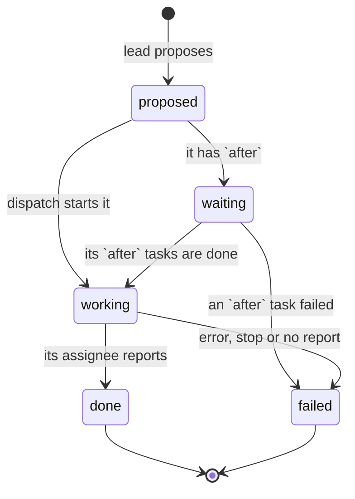
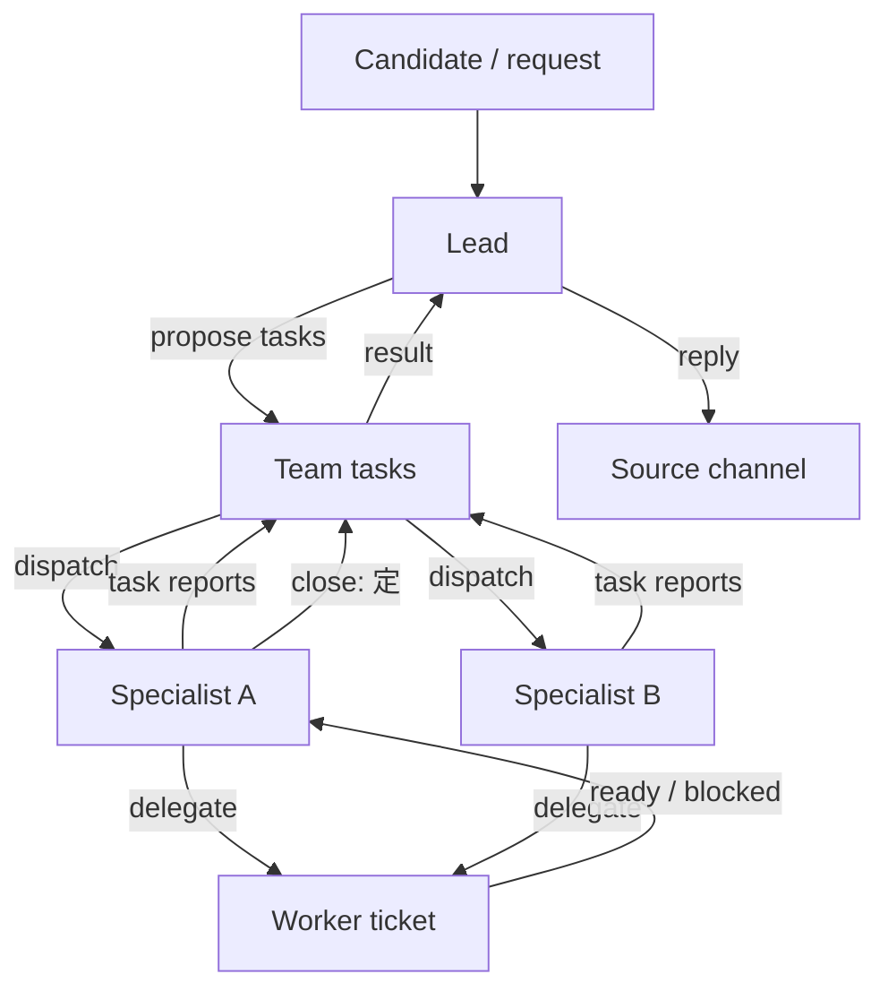

# 009 Multiple superagents

This document describes how dsh-superagent moves from **one orchestrator superagent that routes work to
non-deciding workers** to **a team of superagents**: one lead that admits and coordinates, several
professional superagents that can talk to each other in group and direct chat, and workers that carry
the concrete implementation. It builds on [001 Domain model](001-domain.md), [002 Authorization](002-authorization.md)
and [003 Execution](003-execution.md), and is the design behind the `multi-superagent` fork.

The fork keeps every existing behaviour. Teams are **additive**: a deployment with no team configured runs
exactly the single-superagent system described by the documents before this one.

## Why

A single orchestrator owns all admission and all reporting. Its Session is the one place decisions are
made and the one bottleneck every candidate and every worker report passes through. Splitting the team
into a lead and professional superagents:

- lets each superagent own a **domain and a conversation** (a module, a source, a kind of work) instead
  of one Session juggling everything;
- lets specialists **talk to each other** before work starts, so a division is negotiated and recorded
  rather than inferred by one Session;
- keeps the lead as the **single admission authority**, so the gate, Mandates and Policy stay in one place;
- keeps workers as the **single execution authority**, so implementation stays bounded by a Ticket.

The model follows the group-chat division pattern: a lead closes a discussion, names who does what and in
what order, each member carries its part, reports back, and the lead closes the round. The difference from
a plain chat is that **every message and task is a domain record**, so the same durability, idempotence and
audit that Triggers and Tickets have apply to team talk.

## Roles

| Role | What it is | Where it runs | Decides |
| --- | --- | --- | --- |
| Lead | The admission authority: admits candidates, proposes and dispatches a division, relays results, closes rounds | The main Session (`orchestrator`), extended with team tools | Accept, attach, stop, ignore; who does what |
| Specialist | A professional superagent with its own Session, domain and conversation | A `superagent-<id>` Session under a new preset | Its own task, its messages, and what it delegates to a worker |
| Worker | The concrete executor for a Ticket | A `worker-<ticket>` Session, unchanged | Implementation within its Ticket's Mandate |

The lead **is** the main Session. Specialists are new Sessions. Workers are unchanged.

## Concepts

The domain keeps the existing concepts and adds four. A team is a **conversation between superagents**;
it is not a Source, and its messages are not Triggers.

### Superagent

A first-class agent identity in the domain: `{ id, name, role: 'lead' | 'specialist', capabilities?, directory?, createdAt }`.

- A superagent is the unit of a team's membership and of the Session that runs it.
- `role: 'lead'` names the admission authority. At most one lead exists, and it is the main Session.
- `role: 'specialist'` names a professional superagent. Capabilities are prompt text the lead uses to
  divide work; the core does not interpret them.
- `directory` optionally binds the superagent to its own project directory, so a specialist can be pointed at
  its own checkout or module (one directory per superagent). When it is absent or blank, the runner starts the
  superagent's Session in the machine's **state directory**, as before. The lead sets it through
  `lead_team_create_superagent`; the panel shows it on the team's detail page.
- `persona` is prompt text injected into that superagent's Session, after the shared superagent prompt, so a
  product manager starts knowing it is a product manager. `capabilities` are named in the same section. The core
  still does not interpret either. `skills` names skills bound to that superagent; they are named in its prompt,
  and the Session registers the deployment's skills as before.
- `disabled` pauses a superagent: it keeps its identity, but starts no turn and receives no message.
- One writer: the Engine, through the Teams part.

### Team

A conversation between superagents: `{ id, name, kind: 'group' | 'direct', memberIds, leadId, createdAt, closed? }`.

- `kind: 'group'`: several superagents talk in one place. A message reaches every member's Session.
- `kind: 'direct'`: a private conversation between two superagents (lead and one specialist, or two
  specialists). A message reaches only the two members.
- The lead of a group is the member who proposes the division and closes the round. A direct team has no
  lead; either member can propose, and the recipient decides.
- One writer: the Engine, through the Teams part.

### The all-hands group

One group stands in every deployment: the **all-hands group** (`id: 'all-hands'`). Every bot belongs to it,
so the lead dispatches to anyone without building a group first.

- It appears with the first bot that can lead it, and holds every bot registered so far; a bot registered
  later joins it. Registering a specialist is therefore all it takes to make it dispatchable.
- The person is a member too, because the person speaks there.
- Its lead is the deployment's own lead: the main Session's identity, which the plugin registers at startup
  as a bot of the team, or the first lead-role bot when the main Session holds none. The main Session is
  that lead: a mention of it arrives in the main Session, not in a second one.
- The group is exempt from `TEAM_BOT_LIMIT`, which bounds the groups people build by hand.
- A closed group is not reopened here: only the person reopens a group, by speaking in it. A lead that
  closed the all-hands group stops dispatching in it until the person speaks.

### TeamMessage

One message on a team: `{ id, teamId, from, text, at, kind, taskId?, triggerId? }`, where `kind` is
`discussion`, `task`, `report`, `decision` or `notice`.

- `task`: the message that carries a proposed or dispatched task to its assignee.
- `report`: a superagent's report on a task it finished, which other members read.
- `decision`: the lead's closing summary, the "定：" line of a round.
- A message is the unit of a superagent turn's input. A specialist reads the messages of its team and
  answers with its own report.

### TeamTask

A piece of work assigned to one superagent in a team:
`{ id, teamId, assigneeId, text, state, after, outputs, report?, reason?, createdAt, turn? }`.

| `state` | Meaning |
| --- | --- |
| `proposed` | The lead proposed it; not dispatched yet |
| `waiting` | It waits for the members named in `after` to finish |
| `working` | Its assignee's superagent turn is running |
| `done` | Its assignee reported success |
| `failed` | It failed, with `reason` |

- `after`: the member IDs whose tasks this one waits on. It orders work and records dependencies; it never
  routes.
- `outputs`: the deliverable file paths a task declares, checked before the task is treated as done.
- `turn`: the superagent's current turn, shaped like an Assignment (`state`, `createdAt`, `startedAt`,
  `endedAt`, `report`). It is what the `SuperagentRunner` port starts, delivers to and stops.
- A task is proposed once; dispatching it starts its turn. A member runs **one task at a time**; further
  tasks queue behind it.

The dispatch state machine is the one a group division uses:

A cycle in `after` fails at dispatch, with a notice, rather than waiting forever.

### Team mandate

A Ticket created by a specialist's delegation carries a mandate whose basis is `{ via: 'team' }`, naming
the team, the task and the lead who authorized it. It is revalidated by whether the team is still open and
the task belongs to it; it does not depend on the admission table, because the lead — not a Source sender —
granted it. This is the one new mandate basis; every other basis is unchanged.

## How a round runs

1. **Admit.** The lead receives a candidate or an explicit request exactly as today and decides accept,
   attach, stop or ignore. An accepted request may become a **team** instead of a single Ticket: the lead
   proposes who does what.
2. **Propose.** `lead_propose` records the tasks, each with an assignee, its text, the members it waits on
   and the deliverables it declares. They are `proposed`, not yet working.
3. **Dispatch.** `lead_dispatch` moves tasks to `working` as members free up, starting each assignee's
   superagent Session. `waiting` tasks start once their `after` tasks are `done`; a dependency cycle fails
   the cycle at once.
4. **Work.** A specialist reads its task and the team's messages, does the work, and reports with
   `superagent_team_report`: `done` with its outputs, or `failed` with a reason. It may send messages with
   `superagent_team_message` (group or direct) and delegate concrete implementation to a worker with
   `superagent_delegate`, which creates a Ticket under a team mandate.
5. **Close.** Dispatch returns as soon as the turns are started. The lead acknowledges the person in that same
   turn and ends it; it does not wait for the specialists. When a task is done or failed, a `team_report` is
   steered into the lead's Session, the same way a worker report is. The lead relays only once every task of the
   round is done or failed, then closes. `lead_team_wait` reads reports already in; it does not block.
   `lead_team_message` and `lead_team_close` write as the team's `leadId`, not as the main Session id, because
   that id is not a team member. A message to a specialist with no working task is delivered as talk, which
   starts no task. The lead is the main Session, so talk does not start a second Session for it.
6. **Deliver.** The lead relays the result to the source conversation, exactly as a worker's result is
   relayed today.

A specialist does not admit new work: it can only decide its own task, answer its messages, and delegate
within its task. New admission stays with the lead.

## Where it lives in the code

| Part | Module | Does |
| --- | --- | --- |
| Domain types | `src/core/model.ts` | `Superagent`, `Team`, `TeamMessage`, `TeamTask`, `SuperagentTurn`, the `team` mandate basis, and `superagentWorkspace` (a superagent's directory or the fallback) |
| Port | `src/core/ports.ts` | `SuperagentRunner`: start, deliver and stop a superagent turn; the team repositories |
| Engine part | `src/core/team.ts` | `Teams`: superagent and team records, message routing, the dispatch state machine, the all-hands group, closing |
| Engine | `src/core/engine.ts` | The Teams part, the lead and specialist role interfaces, delegation to a Ticket |
| Runner | `src/executor/dsh.ts` | `DshExecutor` implements `SuperagentRunner`: one superagent Session and its turns, launched in the superagent's bound directory or the state directory |
| Sessions | `src/app/sessions.ts` | The `superagent` role, its preset, its prompt and tools |
| Runtime | `src/app/runtime.ts` | Registers the main Session's lead identity and the all-hands group at startup |
| Lead tools | `src/app/tools/main.ts` (and `src/app/tools/superagent.ts`) | `lead_team_create_superagent` (including its `directory`, `persona` and `skills`), `lead_team_list_superagents`, `lead_team_update_superagent`, `lead_team_create`, `lead_team_propose`, `lead_team_dispatch`, `lead_team_message`, `lead_team_close`, `lead_team_read`, `lead_team_wait` |
| Specialist tools | `src/app/tools/superagent.ts` | `superagent_team_report`, `superagent_team_message`, `superagent_delegate` |
| Prompts | `prompts/` | `lead.md`, `superagent.md`, and the team-communication section |
| Store | `src/app/store.ts`, `src/app/migration.ts` | The `team`, `superagent`, `team_message`, `team_task`, `team_inbox` and `team_cursor` tables, schema 13 |
| Effects | `src/app/effects.ts` | `superagent-launch` and `superagent-delivery` |

### Dependency rules kept

- **One writer per state.** Superagents, teams, messages and tasks are written by `Teams`; the
  `SuperagentRunner` only reports facts back (a turn started, inputs delivered, a turn ended, a failure),
  exactly as `DshExecutor` does for tickets.
- **Explicit, narrow dependencies.** `Teams` depends on the repositories, the Policy, the runner port and
  `Tickets` (for delegation). It imports nothing from `src/app`.
- **Team talk is not a Source.** A team's messages never become Triggers, and a team never enters Eval.
  The lead is the only path from a team to a Ticket.
- **The lead stays the admission authority.** Specialists have no `orchestrator_route`, and no tool of
  theirs creates a Ticket except through delegation under a team mandate.

## Persistence and migration

Teams are stored as JSON rows in six tables (`superagent`, `team`, `team_message`, `team_task`, `team_inbox`, `team_cursor`), opened
with `CREATE TABLE IF NOT EXISTS` on every start, and the schema version moves from 11 to 13. The schema 12 and 13
migrations are additive and empty: older databases have no team rows, so nothing is converted. A deployment
that never created a team runs the existing code path untouched.

## Talking, and the inbox

Talking is what makes a team a team rather than a queue: a superagent answers a mention, and mentions other superagents in
turn. Two decisions keep that from becoming a runaway broadcast.

**A mention wakes, and only a mention.** A message carries a structured `mentions` list, filled from the `at` argument of
`lead_team_message` / `superagent_team_message`. Text is never searched for `@`: writing `@writer` in a sentence wakes nobody,
because guessing who a line is for from prose is exactly the ambiguity that produces both silence and noise. A message that
mentions nobody is recorded for the record and read by whoever reads the group next; it starts no turn.

**Mentions arrive in one batch.** Every mention lands in the mentioned superagent's inbox (`botId`, `messageId`, `teamId`,
`at`, `state`). A wake-up is one effect per superagent, keyed by its id, so ten groups mentioning the same bot at once produce
one wake-up, not ten. The batch is delivered when the superagent is free to act:

- a superagent in the middle of a task reads its inbox with that task; a mention never steers a running turn;
- an idle one waits out a short debounce first, so a burst of mentions merges into one batch;
- a session that goes idle is woken again for anything that arrived while it was busy.

The batch carries, per group, the talk since that superagent's read cursor (`team_cursor`) around the mentions, so a mention
arrives with its context and no group is read twice. One batch holds at most 40 mentions and 15 messages of context per group;
what does not fit waits for the next batch, oldest first.

**The chain has a limit.** Each bot-to-bot mention counts as one hop on the group. At 30 hops the group pauses itself: its
messages are still recorded, but its mentions wake nobody, and a notice says so. The person speaking resets the count and
resumes the group; a manual pause stops the bots but never the person, whose mentions always wake their target.

**The person is a member.** `me` is a fixed superagent identity with `role: 'human'`; it runs no Session, it is added to every
team, and it speaks through the panel. It is never a group's lead: the lead is the admission authority and that stays a bot.

## Where the chat lives

| Part | Module | Does |
| --- | --- | --- |
| Inbox and batch | `src/core/team.ts` | `sendMessage` records mentions into inboxes, `takeBatch` assembles them, `deliverBatch` advances the cursors, `hop` runs the chain limit, `pause` and `resume` |
| Wake-up | `src/executor/dsh.ts` | The `superagent-inbox` effect: one per superagent, debounced, held while the superagent is busy, re-armed when it goes idle. A mention of the lead is queued into the main Session, which already has the lead's tools |
| Storage | `src/app/store.ts` | `team_inbox` and `team_cursor`, schema 13 |
| Panel routes | `src/app/http.ts` | Speaking as the person in any conversation, pulling messages after a point, pausing and resuming |
| Chat | `src/client/chat.tsx` | Bubbles and cards, the mention picker, each superagent's status, and the composer |
| Profiles | `src/app/profiles.ts` | Each superagent's own directory, its `AGENTS.md`, and the skills it can read |

## A superagent's own brief

A superagent's `AGENTS.md` is what it is told before every request, and DSH reads it from the Session's working directory. So
each superagent runs in its own directory: its bound project directory when the lead bound one, and
`<stateDir>/superagents/<id>/` otherwise. A shared directory would give every superagent the same brief.

`profiles.ts` reads and writes that file, refusing a save over a version it did not read, and lists the skills a superagent can
read: the ones bound to it, the deployment's own, and any under its directory's `.agents/skills`.

## Skeleton status

The `multi-superagent` fork delivers the design above as a **runnable skeleton**:

- the four domain concepts, the dispatch state machine, dependency ordering and cycle detection, closing,
  the team-mandate basis, and a superagent's bound project directory (optional, falling back to the state
  directory), with unit tests over in-memory repositories;
- the standing all-hands group: every bot belongs to it, so the lead dispatches to any of them without
  building a group first;
- the `SuperagentRunner` port and its `DshExecutor` implementation, with superagent Sessions;
- the lead and specialist tools, including `lead_team_wait`, and the `superagent` prompt role, which names the superagent and injects its persona;
- the team tables, the inbox and cursors of schema 13;
- the Web panel's Team tab: the list of team conversations, one team's tasks and messages, and closing a
  round from the panel.

Deferred to a later change, and not claimed by the skeleton:

- team-aware Source admission (a team still receives work only through the lead);
- automatic division (the lead still proposes explicitly);
- direct superagent-to-superagent ticket hand-off beyond delegation under a team mandate.

## Risks

- **Two admission paths.** Delegation creates a Ticket without a Source Trigger. The team mandate is the
  safeguard; a closed team cannot authorize new work, and a specialist cannot delegate outside its task.
- **Superagent turns are long.** A specialist turn can run far longer than a worker's. The runner bounds it
  and reports a failure rather than hanging, and a turn is stopped when its task ends.
- **Group noise.** The philosophy of [000](000-philosophy.md) still governs: team talk is internal unless a
  person must act or can use a result. The lead relays, specialists do not.
